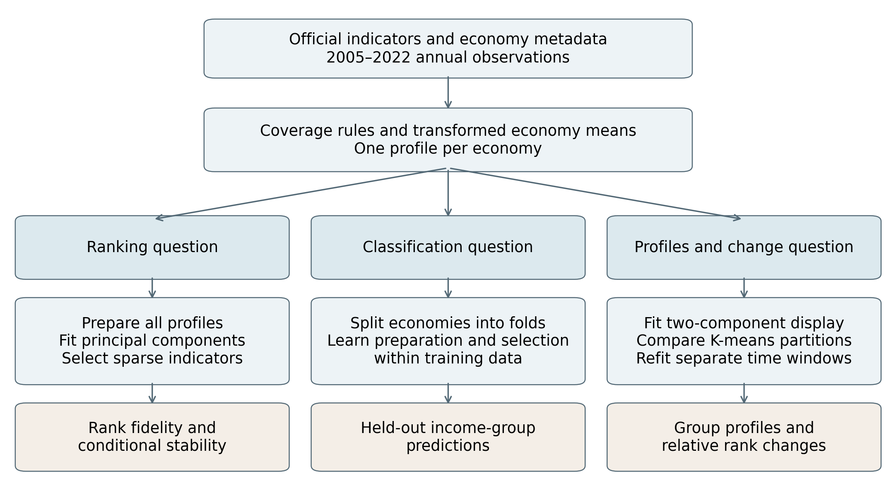
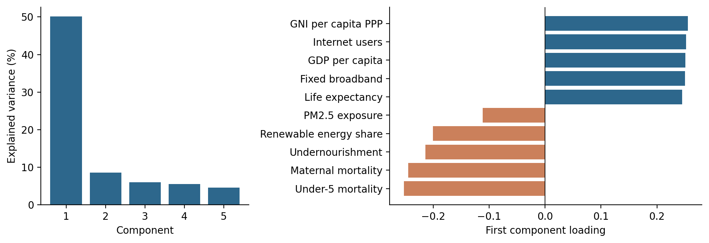
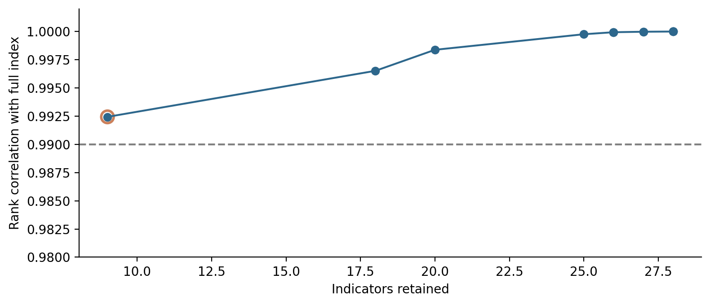
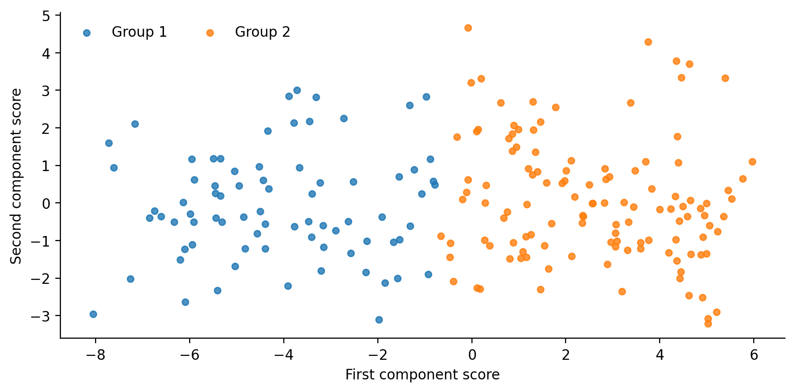

# Reducing Development Indicators While Preserving Country Rankings and Income Classification
Group16: Chen Wanchuan，Lu Yuqing，Yuen Lok Yan

## Abstract

This study asks whether a smaller set of development indicators can preserve country rankings, retain income-group classification performance and reveal useful differences between country profiles. We analyse 28 World Development Indicators for 198 economies, using country averages over 2005–2022 from the official archive downloaded on 19 November 2026. Principal component analysis provides a descriptive reference index, sparse component estimation selects a shorter indicator set, and training-fold evaluation compares classification procedures. The first component explains 50.1% of standardised variance. A 9-indicator subset achieves a Spearman rank correlation of 0.992 with the full index. Held-out macro-averaged F1 scores are 0.844 for the full random forest and 0.856 for the procedure that reselects a sparse subset within each training fold. The training-fold sparse lists contain 17–18 indicators, so the held-out result does not validate the fixed nine-indicator candidate. The results distinguish preservation of a descriptive ranking from prediction of an administrative income category. They support a shorter candidate dashboard for this indicator menu, while leaving its external validity and policy usefulness to further evaluation.

## 1 Introduction and research questions

Development monitoring combines measures of income, health, education, infrastructure and environmental conditions. These variables describe different aspects of an economy, but some also move together. Collecting a longer list can therefore add detail without changing an economy's broad position. Conversely, a short list may remove information needed to distinguish economies with similar incomes. Guidance on composite indicators stresses that selection, normalisation, weighting and sensitivity analysis must be justified together; a stable numerical index is not automatically a valid measure of development (OECD et al., 2008).

Our research question develops from the course themes of exploratory analysis, dimension reduction, regularisation, supervised learning and unsupervised learning. Dimension reduction suggests asking whether correlated indicators share a common direction. Regularisation suggests testing whether that direction can be represented using fewer inputs. Classification provides a separate test of whether the retained information helps distinguish known categories, while clustering asks whether economies have different profiles beyond a single ordering. These connections motivate the analysis; we do not treat the use of more algorithms as a research objective.

The overarching question is how far the indicator set can be reduced without losing the information required for a specified task. We address three linked questions. First, does the selected development data contain a dominant and stable ranking direction? Second, can a shorter indicator set preserve that ranking and retain income-group classification performance when selection is evaluated on held-out economies? Third, do multivariate groupings and changes in rank provide information that a single ordering conceals?

The study's contribution is an integrated comparison of these three tasks on one documented dataset. We define success separately for compression, classification and country profiles. A high correlation with an internally constructed index measures fidelity to that index. It does not establish that the index is an external ground truth, that the selected subset is globally minimal, or that a particular policy intervention would improve development.

## 2 Data and preparation

The source is the World Bank's World Development Indicators bulk CSV archive supplied for this revision (World Bank, 2026). Its files are dated 16 November 2026; the download date is 19 November 2026. We examine 28 indicators spanning the economy, human development, urbanisation and energy, environment, digital connectivity, and agriculture and food. Appendix A lists the retained variables in readable form. These are a chosen subset of the database, not an exhaustive definition of development.

Regional aggregates are excluded using the archive's economy metadata, while economies and territories with a non-empty region remain eligible. Restricting the annual observations to 2005–2022 gives 3,906 candidate economy-years. We exclude observations with fewer than 60% of the 28 indicators recorded, leaving 3,517 economy-years. We then require at least 60% indicator coverage in each economy's aggregated profile, giving 198 economies. These filters limit dependence on imputation but can reduce representation of economies with weaker reporting systems. A territory is an economy-level reporting unit here, not necessarily an independent country.

The preparation order follows the intended unit of analysis. We first apply log(1 + x) to the positive magnitude series identified in Appendix A, reducing the influence of long right tails. We then average each transformed indicator over the available years for each economy. Averaging reduces year-specific fluctuations and avoids treating repeated observations of the same economy as independent training examples. It also changes the question: the main analysis concerns average profiles over 2005–2022, rather than a country's current situation or an annual forecast.

At this stage, 198 of the 5,544 economy–indicator cells are missing (3.6%). For the descriptive analysis, each variable is clipped at its first and ninety-ninth percentiles across economy means, scaled using its observed mean and standard deviation, and filled using five-nearest-neighbour imputation. Scaling before the neighbour search prevents variables with large numerical units from dominating the distance. A final standardisation gives each completed variable unit variance. These choices reduce scale effects; they do not eliminate uncertainty from missing or potentially non-random observations.

Figure 1. Missingness for the 14 indicators with the highest pre-filter missingness, before and after the economy-year coverage filter, using the official 2005–2022 panel. Percentages concern annual observations before imputation, not the aggregated country matrix.
Figure 1 shows why preparation is necessary before modelling. Reporting completeness differs across indicators, so excluding the least complete economy-years reduces missingness but does not remove it. The graph describes the retained sample's coverage; it cannot establish why observations are missing or show that the missingness mechanism is random. The later imputation step therefore remains a modelling assumption.

The classification analysis relearns clipping thresholds, scaling and imputation using training economies only. Held-out economies are transformed using those fitted operations. For a selected subset, the classifier's preprocessing is fitted again using only the retained inputs, so its held-out predictions do not borrow information from discarded variables. Separating preparation from evaluation is necessary because even unsupervised preprocessing can transmit information from test observations into a fitted procedure (scikit-learn developers, n.d.).

## 3 Methods and their purposes

Figure 2 sets out how the research questions determine the analysis. The descriptive ranking and grouping paths use the prepared reference profiles, while the classification path splits economies before learning preprocessing and selection. Keeping these paths distinct prevents an in-sample description from being presented as held-out predictive evidence.

Figure 2. Analysis workflow linking preparation to ranking, classification and profile comparison. Time-window indices are refitted separately; all learned prediction steps are confined to the relevant training partition.
To answer the first question, we fit principal component analysis to the completed standardised matrix. The first direction maximises the variance of a linear projection subject to a unit-length loading vector. Equivalently, it is the leading eigenvector of the sample covariance matrix. This connects the analysis to linear algebra and constrained optimisation. The index for an economy is its standardised indicator vector projected onto that direction; we orient the sign so that the loading on gross domestic product per capita is positive. The method discovers covariance structure, rather than choosing normative welfare weights (Jolliffe & Cadima, 2016).

We report the first component's variance share and assess whether the ordering is sensitive to indicator removal and resampling economies. Each leave-one-indicator-out analysis refits the component and compares its ranking with the full index using Spearman correlation. Two hundred bootstrap resamples refit the component on the completed standardised profiles. Their variance shares give a percentile interval, and their loading vectors are applied to the reference profiles to assess ranking stability. Because this bootstrap holds the initial preprocessing fixed, its uncertainty is conditional on the prepared matrix; it does not propagate every source of measurement or imputation uncertainty.

For the second question, we use the scikit-learn single-component sparse estimator, which penalises absolute loading values while seeking a low-rank reconstruction. The penalty encourages zero loadings and supplies a connection to regularisation and the fit–complexity trade-off (Zou et al., 2006; scikit-learn developers, n.d.). We evaluate thirteen penalty values from 0.05 to 12. For each non-empty support, an ordinary first principal component is refitted using only the retained variables. Its absolute Spearman correlation with the full index measures ranking fidelity. This avoids attributing a two-direction variance measure to the support of just one direction.

Our declared selection rule chooses the smallest support on this penalty grid whose ranking correlation reaches 0.99; ties favour the larger penalty. The threshold is a practical fidelity criterion, not a significance test. This selects a candidate from the fitted regularisation path, not a proven minimum over all possible variable subsets. Two hundred bootstrap fits at the selected full-sample penalty describe how often individual variables survive. The reduced index and its fidelity are descriptive, in-sample summaries; the separate classification evaluation addresses held-out performance.

Income-group classification tests a different property. The target is the Income Group field accompanying the downloaded economy metadata, rather than an assumed historical fiscal-year classification. The World Bank bases income categories on gross national income per capita converted using the Atlas method (World Bank, n.d.). Income-related inputs therefore make this a related administrative classification task, not an independent validation of overall development. We also remove both income-per-capita indicators in a sensitivity analysis to assess reliance on that relationship.

We compare random forests with logistic regression. A random forest averages decision trees built with randomisation, allowing nonlinear relationships and interactions; logistic regression provides a simpler linear decision-boundary comparison (Breiman, 2001). Forests use 200 trees, and logistic regression uses its default regularisation with a maximum of 3,000 iterations. These are fixed specifications, not models tuned to the outer test results. We use a shared five-fold stratified split, with each economy held out once. All preparation and sparse-support selection are repeated inside the training fold. Consequently, the reduced classification result evaluates a selection procedure whose variables and size can differ between folds.

A three-indicator supervised screen provides an additional comparison under a fixed input budget. Within each outer training set, greedy forward selection adds three variables using balanced accuracy in three inner stratified folds and a 60-tree forest. Every inner fold relearns preprocessing. A 200-tree forest is then fitted to the chosen variables in the outer training set and evaluated on the outer held-out economies. The nested design separates feature choice from assessment, following the principle described by Varma and Simon (2006). It estimates the performance of selecting three variables, not the performance of a single universally fixed list.

We pool the held-out predictions and report accuracy, balanced accuracy and macro-averaged F1. Accuracy weights economies equally; balanced accuracy averages class recalls; macro-averaged F1 gives each income class equal weight when combining precision and recall. The latter two help prevent the largest class from dominating interpretation. A small difference between two pooled scores is descriptive and is not evidence of statistical equivalence. We do not present the five folds as independent experimental replications.

For the third question, we apply K-means to the first two principal component scores. This minimises within-group squared distances and makes the grouping visible in a low-dimensional display. We compare two to six groups and choose the number with the largest silhouette score, which contrasts within-group cohesion with distance to the nearest alternative group (Rousseeuw, 1987). Two hundred bootstrap refits provide an additional stability diagnostic using the adjusted Rand index against the reference partition, evaluated on all reference economies. The component projection is held fixed, so this diagnostic concerns partition stability in that display, not the stability of the entire analytical pipeline.

Finally, we rebuild the index separately for 2005–2009 and 2015–2019, applying the same coverage and preparation rules within each window. We compare ranks only among economies available in both windows and recompute the ranks on that common population. This distinguishes changing relative position from a changing comparison set. The two indices have separately estimated directions and scales, so their numerical score differences are not treated as a common-unit measure of development progress.

## 4 Results

For the first research question, the first component explains 50.1% of total standardised variation and the first two explain 58.7%. The first direction is therefore prominent, but substantial variation remains outside it. Its bootstrap percentile interval is 46.6% to 53.7%. The minimum ranking correlation after deleting one indicator is 0.999; correlations from the conditional bootstrap range from 0.998 to 1.000. These checks support stability within this indicator menu, rather than proving that development is one-dimensional.

Figure 3. Variance explained by the leading components and the largest positive and negative first-component loadings. Signs indicate association with the fitted index, not whether an indicator is desirable.
For the second question, the selected penalty is 12, retaining 9 indicators and producing a ranking correlation of 0.992 with the full index. The selected indicators are gross domestic product per capita, gross national income per capita at purchasing power parity, Life expectancy, Under-5 mortality, Maternal mortality, Secondary enrolment, Energy use per capita, Internet users, Fixed broadband. This is a candidate compression of the chosen 28-variable reference. A high correlation can coexist with meaningful rank changes among neighbouring economies and says nothing about information absent from that reference.

Figure 4. Number of retained indicators and ranking fidelity along the sparse-estimation penalty path. The dashed line marks the declared 0.99 criterion; the marked candidate is selected without income labels.
| Procedure | Accuracy | Balanced accuracy | Macro F1 |
|---|---|---|---|
| All indicators with random forest | 0.859 | 0.833 | 0.844 |
| Sparse selection with random forest | 0.864 | 0.849 | 0.856 |
| All indicators with logistic regression | 0.793 | 0.771 | 0.773 |
| Sparse selection with logistic regression | 0.778 | 0.754 | 0.758 |
| Nested three-variable selection | 0.843 | 0.813 | 0.820 |
| Random forest without income variables | 0.828 | 0.811 | 0.823 |
Table 1. Pooled held-out predictions for 198 economies under the same five outer folds. Preparation is fitted within training data; selected lists are re-estimated rather than fixed using the full sample.
The full random forest achieves macro-averaged F1 of 0.844, compared with 0.856 for the sparse-selection procedure. The signed difference, reduced minus full, is +0.013. Training-fold sparse supports contain 18, 18, 18, 18, 17 indicators. Thus the classification estimate does not validate one fixed 9-variable list. It assesses whether a rule that selects a shorter list can retain useful predictive information.

Figure 5. Confusion matrices for held-out random-forest predictions using all indicators and training-fold sparse selection. Each cell shows the number of economies and its percentage within the recorded income class. Each economy contributes one prediction to each matrix; the reduced supports contain 17–18 indicators.
Figure 5 shows that errors occur between adjacent income categories. Both procedures correctly classify 62 of 68 high-income economies and 37 of 47 lower-middle-income economies. The sparse-selection procedure identifies 20 of 25 low-income economies, compared with 18 for the full model, while correctly classified upper-middle-income economies decrease from 53 to 52 out of 58. Thus the slightly higher macro-averaged score reflects a change in the distribution of errors rather than uniform improvement across classes. Any apparent improvement concerns this shared held-out split and the fold-specific selection procedure, rather than a guarantee that the fixed nine-indicator descriptive list predicts equally well. These matrices support the second research question by showing where classification information is retained and where errors remain.

The nested three-variable procedure gives balanced accuracy 0.813 and macro-averaged F1 0.820. This result concerns a deliberately severe input restriction, not a discovered optimal input count. Removing both income variables gives random-forest macro-averaged F1 0.823. The comparison shows how sensitive the classification is to income-related inputs; it cannot turn an administrative income label into a comprehensive measure of social or environmental development.

| Groups | Silhouette | Bootstrap adjusted Rand index |
|---|---|---|
| 2 | 0.533 | 0.938 |
| 3 | 0.434 | 0.948 |
| 4 | 0.433 | 0.831 |
| 5 | 0.379 | 0.683 |
| 6 | 0.370 | 0.593 |
Table 2. Candidate K-means partitions in the two-component display. Stability values are means across 200 resampled fits with the projection fixed.
For the third question, the silhouette criterion selects 2 groups, containing 77, 121 economies. The grouping describes regions of the projected data rather than naturally discrete development stages. In particular, the display contains only 58.7% of the variation, so apparent separation can conceal differences on omitted directions. Group profiles can guide which original indicators to inspect; they do not establish policy prescriptions.

Figure 6. Economies in the first two component directions, coloured by the silhouette-selected K-means partition. The first component is oriented towards higher income; the second component has an arbitrary sign.
The first group combines below-average income, connectivity and life expectancy with above-average child and maternal mortality; the second shows the opposite broad pattern. These differences explain why the partition largely follows the leading development gradient. They support using the original indicator profiles to describe contrasting conditions, but the labels remain descriptive and should not be read as fixed stages that all economies must pass through.

Across the two non-overlapping windows, 196 economies are shared and their ranking correlation is 0.986. On this common comparison set, the largest positive changes are China (+28 places), Georgia (+25 places), Qatar (+22 places); the largest negative changes include Jamaica (-24 places), Libya (-24 places), Venezuela, República Bolivariana de (-40 places). A positive number means a higher relative position in the later window. These are descriptive changes in rank, not causal estimates or proof of absolute improvement.

Figure 7. Rank changes for the three largest gains and three largest losses among the 196 economies shared by both time windows. Blue markers show 2005–2009 and orange markers show 2015–2019; signed labels give earlier rank minus later rank. These deliberately selected extremes do not represent the typical economy.
Figure 7 complements the high cross-window ranking correlation by showing that an overall stable ordering can contain substantial individual movements. Both markers use ranks recomputed on the same 196 economies, so changes do not arise merely from adding or removing comparison economies. The figure addresses the change component of the third research question, while leaving the causes of those movements untested.

## 5 Discussion and limitations

The results answer different questions that should remain separate. A principal component summarises covariance; sparse estimation seeks a simpler representation; classification assesses held-out category prediction; clustering describes similarities. The distinction connects directly to the course's treatment of unsupervised and supervised objectives. Optimising variance retention does not necessarily preserve a decision boundary, and finding a stable partition does not make its groups suitable policy targets. These differences explain why an indicator list should be judged against the task it is intended to perform.

The practical implication is to treat the selected subset as a candidate reporting layer above the full data. A shorter display can make a broad ordering easier to communicate, while the remaining variables support examination of health, education, environmental conditions and other dimensions. The study has not measured collection costs, field usability or the consequences of replacing a real monitoring system. Therefore it does not justify instructing agencies to stop collecting the discarded variables.

Several limits constrain the conclusion. The 28-variable menu is selected by judgement and excludes governance, inequality and other important dimensions. Its variables are not independent measures: some reflect overlapping economic processes and shared statistical systems. A dominant direction can partly represent this overlap. In addition, the index is oriented towards income, and a loading's sign is an empirical association rather than a welfare judgement. For example, an unfavourable sign on renewable energy share would not show that renewable energy reduces development.

Country averages combine observations from unequal numbers of years. Missingness may be concentrated among economies with weaker statistical capacity, and nearest-neighbour filling can smooth genuine differences. Log transformations and clipping also alter the geometry used by the methods. The conditional bootstrap does not capture those choices, and the panel's common reporting source can produce correlated measurement error. Results should consequently be interpreted as properties of a documented data preparation, not as an uncertainty-free global ranking.

The classification sample is small and uses one seeded five-fold partition. Its scores can change with the split, and no independent external dataset has been used. The downloaded income groups describe the archive's classification snapshot, whereas the predictors average 2005–2022; the task measures association with that snapshot and is not a time-respecting forecast. Selecting a convenient input count after reviewing outer-fold scores would require another assessment stage. We therefore retain the predeclared three-variable restriction and fidelity threshold without claiming they are universally optimal.

Further work should first repeat the complete procedure across additional split seeds and alternative imputation or scaling rules. It should then test the candidate subset on another period, measure the consequences of excluding income-related variables from index construction, and assess group stability while refitting the projection. These checks would address generalisation and construct validity before adding more complex predictive models. The current study demonstrates the workflow and its trade-offs, not a validated replacement for established development measures.

## 6 Conclusion

The first research question receives a qualified positive answer: a prominent direction explains 50.1% of the selected data's variation and produces a ranking that is stable under the reported conditional checks. The remaining variation prevents us from equating that direction with the whole of development.

For the second question, 9 indicators on the evaluated regularisation path reproduce the full-sample ranking at correlation 0.992. The training-fold selection procedure achieves macro-averaged F1 0.856, against 0.844 for the full random forest. This supports investigating a shorter dashboard for the specified tasks; it does not prove a minimum input set or statistical equivalence.

For the third question, the data support a 2-group descriptive partition in the two-component display and a cross-window ranking correlation of 0.986. Group profiles and relative movements complement the ordering, while remaining sensitive to representation and preparation. Taken together, the findings show why indicator reduction should be evaluated through explicit research questions: fewer inputs may preserve a broad ranking, but neither ranking fidelity nor income classification alone establishes complete or policy-ready measurement of development.

## References

Breiman, L. (2001). Random forests. *Machine Learning, 45*, 5–32. https://doi.org/10.1023/A:1010933404324

Jolliffe, I. T., & Cadima, J. (2016). Principal component analysis: A review and recent developments. *Philosophical Transactions of the Royal Society A: Mathematical, Physical and Engineering Sciences, 374*(2065), Article 20150202. https://doi.org/10.1098/rsta.2015.0202

OECD, European Union, & European Commission Joint Research Centre. (2008). *Handbook on constructing composite indicators: Methodology and user guide*. OECD Publishing. https://doi.org/10.1787/9789264043466-en

Rousseeuw, P. J. (1987). Silhouettes: A graphical aid to the interpretation and validation of cluster analysis. *Journal of Computational and Applied Mathematics, 20*, 53–65. https://doi.org/10.1016/0377-0427(87)90125-7

scikit-learn developers. (n.d.). *User guide*. scikit-learn. Retrieved November 19, 2026, from https://scikit-learn.org/stable/user_guide.html

Varma, S., & Simon, R. (2006). Bias in error estimation when using cross-validation for model selection. *BMC Bioinformatics, 7*, Article 91. https://doi.org/10.1186/1471-2105-7-91

World Bank. (n.d.). *How does the World Bank classify countries?* World Bank Data Help Desk. Retrieved November 19, 2026, from https://datahelpdesk.worldbank.org/knowledgebase/articles/378834-how-does-the-world-bank-classify-countries

World Bank. (2026). *World development indicators* [Data set]. Retrieved November 19, 2026, from https://datatopics.worldbank.org/world-development-indicators/

Zou, H., Hastie, T., & Tibshirani, R. (2006). Sparse principal component analysis. *Journal of Computational and Graphical Statistics, 15*(2), 265–286. https://doi.org/10.1198/106186006X113430

## Appendix A Indicator definitions and transformations

The following menu defines the input variables used in this study. Variable codes identify the official series for verification and are confined to this appendix. Positive magnitude variables marked Yes are transformed with log(1 + x) before averaging; the other variables remain on their recorded scale until clipping and standardisation. A high component loading does not establish that an indicator is normatively desirable.

| Indicator | Official series code | Log transform |
|---|---|---|
| GDP per capita | NY.GDP.PCAP.CD | Yes |
| GNI per capita PPP | NY.GNP.PCAP.PP.CD | Yes |
| GDP growth | NY.GDP.MKTP.KD.ZG | No |
| Trade openness | NE.TRD.GNFS.ZS | No |
| Unemployment | SL.UEM.TOTL.ZS | No |
| FDI inflow | BX.KLT.DINV.WD.GD.ZS | No |
| Life expectancy | SP.DYN.LE00.IN | No |
| Under-5 mortality | SH.DYN.MORT | Yes |
| Maternal mortality | SH.STA.MMRT | Yes |
| Secondary enrolment | SE.SEC.ENRR | No |
| Tertiary enrolment | SE.TER.ENRR | No |
| Health spending | SH.XPD.CHEX.GD.ZS | No |
| Measles immunisation | SH.IMM.MEAS | No |
| Urbanisation | SP.URB.TOTL.IN.ZS | No |
| Energy use per capita | EG.USE.PCAP.KG.OE | Yes |
| Electricity access | EG.ELC.ACCS.ZS | No |
| Renewable energy share | EG.FEC.RNEW.ZS | No |
| Renewable electricity | EG.ELC.RNEW.ZS | No |
| CO2 emissions per capita | EN.GHG.CO2.PC.CE.AR5 | Yes |
| PM2.5 exposure | EN.ATM.PM25.MC.M3 | Yes |
| Forest cover | AG.LND.FRST.ZS | No |
| Water withdrawal | ER.H2O.FWTL.ZS | Yes |
| Agricultural land | AG.LND.AGRI.ZS | No |
| Internet users | IT.NET.USER.ZS | No |
| Mobile subscriptions | IT.CEL.SETS.P2 | Yes |
| Fixed broadband | IT.NET.BBND.P2 | Yes |
| Cereal yield | AG.YLD.CREL.KG | Yes |
| Undernourishment | SN.ITK.DEFC.ZS | No |
Table A1. The 28 selected official development series. Definitions and units follow the accompanying World Development Indicators series metadata.

## Statement of Individual Contribution

The three authors contributed equally. The work ran in four streams, and every author took part in all four: (i) problem framing and literature, (ii) data construction and code, (iii) experiments and robustness checks, (iv) writing, figures and review. The table records the primary owner of each stream; the percentage is the share of total effort.

| Member | Student ID | Primary responsibility | Contribution |
|---|---|---|---|
| Chen Wanchuan | 26108204G | Problem framing; index construction and stability analysis; Sections 1–2 and 6 | 33.3% |
| Lu Yuqing | 26079015g | Data pipeline, imputation and coverage analysis; the two shortlist procedures; Sections 3–4 | 33.3% |
| Yuen Lok Yan | — | Classification, archetypes and dynamics; robustness checks; Sections 5 and 7; figure and table production | 33.3% |

We confirm that all three authors reviewed the complete analysis, re-ran the pipeline end to end on the released code, and checked every reported number against the artefacts in `results/`. Drafting of code and text was assisted by an AI coding tool; all outputs were verified against the released artefacts by the authors, who take full responsibility for the content.

Declaration. The data are public (World Bank WDI, CC BY 4.0) and were retrieved through the official API. No proprietary or personal data were used. The code, the intermediate artefacts and the exact commands to regenerate every table and figure accompany this submission.
